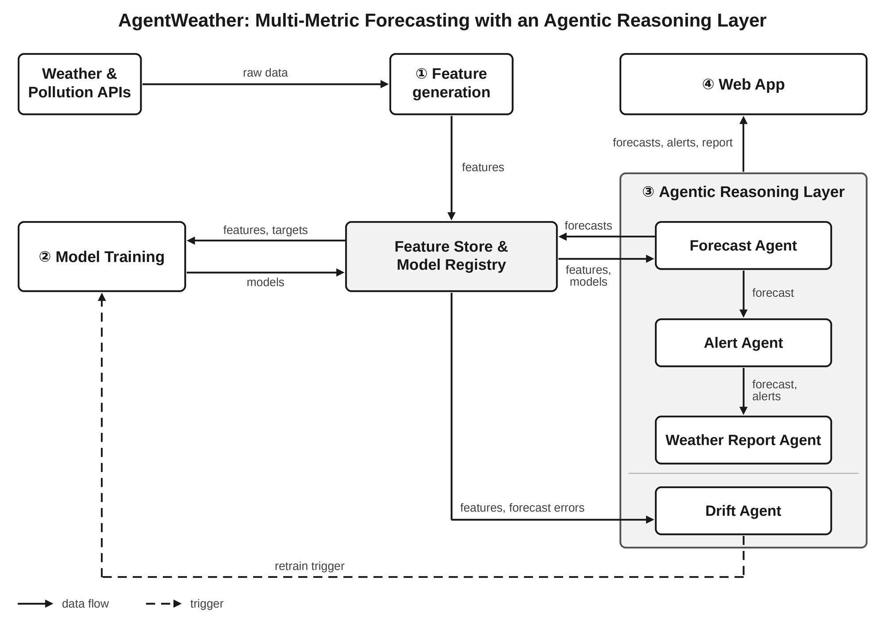

**10Pearls**

**SHINE Internship**

**Cohort 10**

2026

**AgentWeather**

Agentic Multi-Metric Weather & AQI Forecasting System

# **1. Project Overview**

AgentWeather forecasts six weather and air-quality metrics for the next 24 hours, on a fully managed serverless stack.

On top of the forecasts sits a LangGraph agent layer. The agents produce the forecast, write alerts and a news-style weather report, and watch for drift. Every agent decision is logged.

*Figure 1. End-to-end architecture.*

## **Technology Stack**

Required technologies and tools:

- Python

- Scikit-learn

- TensorFlow or PyTorch

- SARIMAX or Prophet

- Hopsworks for the Feature Store and Model Registry

- LangGraph

- Any LLM API, such as the free Groq API

- GitHub Actions

- Streamlit or Gradio

- OpenWeather and AQICN APIs

- SHAP or LIME

- Git

# **2. Metrics to Predict**

- Air Quality Index (AQI)

- Temperature (°C)

- Precipitation (mm and rain probability)

- Humidity (%)

- UV Index

- Wind (speed and direction)

Choose a city and fetch its weather data from any available sources (e.g. OpenWeather, AQICN). Predict each metric 24 hours ahead, using either one model per metric or one model for all six. Judge your predictions with RMSE, MAE and R².

# **3. Data & Feature Pipeline**

A Python script that runs **every hour**:

1.  **Fetches** weather and pollutant data for your city.

2.  **Fuses & time-aligns** sources into one record per timestamp (average them, use a source priority, or keep both as separate features).

3.  **Imputes** missing values (API downtime, sensor gaps) with a documented strategy.

4.  **Computes features:** time-based (hour, day, month) and derived (rate-of-change, rolling averages).

5.  **Stores** features and raw observations in the Feature Store (Hopsworks free tier).

# **4. Backfill Historical Data**

Run the same script for past dates to build training data, then create targets by shifting observations 24 hours ahead. The newest 24 hours have no target yet, so they are used for forecasting only.

# **5. Training Pipeline**

A Python script that runs **every day**, and when the Drift Agent asks for it:

1.  **Fetches** features and targets from the Feature Store.

2.  **Trains & evaluates** at least 3 models from different families: statistical (e.g. SARIMAX, Prophet), classical ML (e.g. Ridge, Random Forest) and deep learning (e.g. LSTM). Use a time-based split. Compare all models with a **naive baseline** (the value from 24 hours ago) and report scores for each metric.

3.  **Stores** models in the Model Registry. A new model replaces the current one only if it scores better on validation.

# **6. Agentic Reasoning Layer**

All four agents are nodes of one LangGraph graph. They share one state, saved in the Forecast Ledger between runs. The Forecast Agent runs every hour, after ingestion, followed by the Alert Agent and the Drift Agent; the Weather Report Agent runs daily and after a new alert.

| **Agent**          | **What it does**                                                                                                                                                                                                      |
|--------------------|-----------------------------------------------------------------------------------------------------------------------------------------------------------------------------------------------------------------------|
| **Forecast**       | Fetches the latest features and the current best model from the Model Registry, produces the 24h-ahead forecast for each metric, saves it to the Feature Store, and passes it to the Alert and Weather Report agents. |
| **Alert**          | Fixed rules check the forecast for hazards in any of the six metrics. If one triggers, the agent writes the alert for the general public, sensitive groups and outdoor workers.                                       |
| **Weather Report** | Writes one news-style report from the forecasts and alerts.                                                                                                                                                           |
| **Drift**          | Runs the drift detection pipeline. Alerts the team and starts an extra training run when drift crosses a threshold.                                                                                                   |

## **Rules:**

- The Alert and Weather Report agents can use any LLM (e.g. the free Groq API), and should have proper fallbacks.

- The Drift Agent should check for both **Data drift** *(compares live features with training features)* and **Model drift** *(compares recent forecast error with the usual error from validation).*

- Proper logging should be stored in the Feature Store as well:

  1.  **Forecast Ledger:** every forecast made by the model (time, metric, forecast).

  2.  **Agent call log:** prompt, response, latency and status of every LLM call. Failed calls form the failure log.

  3.  **Drift log:** each drift event (time, metric, drift type, score, threshold, action taken).

# **7. Automated Pipeline**

Create a CI/CD pipeline using GitHub Actions that runs:

| **Job**                  | **When**                |
|--------------------------|-------------------------|
| Feature/ingestion script | Every hour              |
| Training script          | Every day, and on drift |

# **8. Guidelines**

- Perform thorough EDA on each metric before modelling.

- Explain your models with SHAP, LIME or another explainability method.

- Add alerts for hazardous levels across all metrics.

# **9. Final Submissions**

Submit the GitHub repository URL only. The repository must contain the items below, including the dashboard URL and the report.

1.  **Forecasting system:** end-to-end and automated, with a working agentic layer.

2.  **Dashboard:** deployed on a free host (Streamlit Community Cloud, HuggingFace Spaces or Render) and presented as a weather report. Include the URL of the deployed, publicly accessible dashboard. It shows:

    - 24h forecasts for all six metrics

    - The news-style weather report

    - An "Agent Activity" panel: alerts

    - EDA and SHAP/LIME explanations

    - Drift events and metrics, and failed agent calls

3.  **Report:** sources, imputation, model choices, issues and fixes, and agent performance (alert quality, drift detection and LLM call failures).
